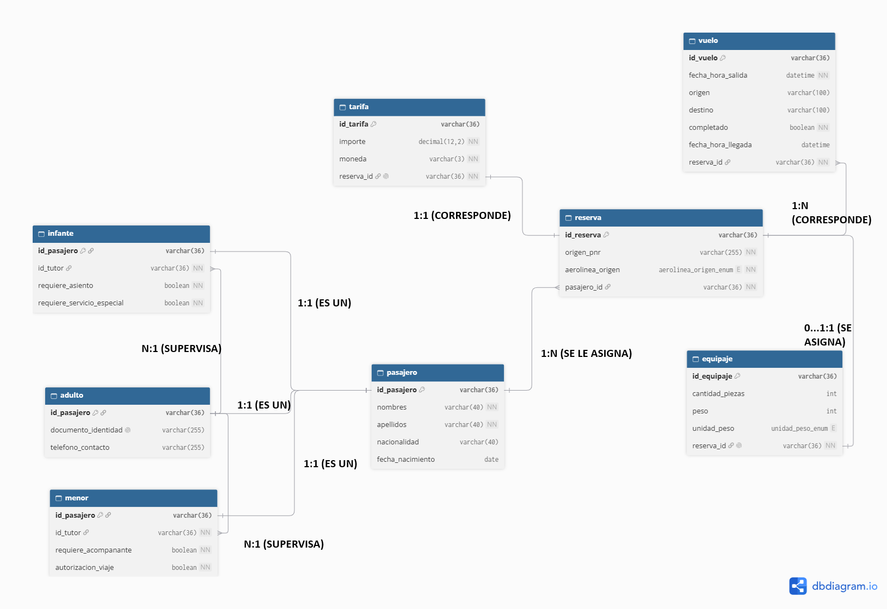

# API de Integración y Servicios de Reserva — Alianza de Aerolíneas "Alas del Sur"

API REST basada en Arquitectura Orientada a Servicios (SOA) y el patrón **Canonical Data Model (CDM)** para la gestión e integración de reservas heterogéneas entre aerolíneas aliadas: **AeroNorte** (XML), **SurJet** (JSON con zona horaria ISO) y **CaribeAir** (JSON anidado).

El sistema normaliza los mensajes heterogéneos al modelo canónico común, valida bidireccionalmente contra esquemas formales **XML Schema (`alianza.xsd`)** y **JSON Schema (`reserva.schema.json` Draft 2020-12)**, y provee una capa completa de operaciones CRUD por entidad para el ecosistema de la alianza.

Desarrollada con **Spring Boot 3.3.4**, **Spring Data JPA** y **MySQL**.

---

## Autor

**Gerardo Yeray Chelius Altamirano**  
7°B de Ingeniería en Sistemas Computacionales

---

## Diagrama



---

## Tecnologías utilizadas

| Tecnología | Versión | Rol |
|---|---|---|
| Java | 21 LTS | Lenguaje de desarrollo principal |
| Spring Boot | 3.3.4 | Framework base de la aplicación |
| Spring Data JPA | — | Capa de persistencia (ORM con Hibernate) |
| Spring Web MVC | — | Controladores REST y exposición de endpoints HTTP |
| Bean Validation | — | Validación declarativa de entidades |
| MySQL | 8+ | Base de datos relacional principal |
| MySQL Connector/J | — | Driver JDBC para conexión a base de datos |
| JSON Schema Validator (`networknt`) | 1.5.1 | Validación sintáctica y semántica Draft 2020-12 |
| XML Schema (XSD) / DOM JDK | Nativo Java 21 | Parseo, validación y generación XML con mitigación XXE |
| Maven / Gradle | 3.9+ / 9.8+ | Ciclo de vida de compilación y gestión de dependencias |

---

## Requisitos previos

- **Java 21 LTS** instalado y configurado en el `PATH` (`java -version`).
- **MySQL 8+** en ejecución con la base de datos `alianza` (o la configurada en `.env`).
- **Maven 3.9+** (o Gradle mediante `gradlew`).
- Puerto de red **6767** disponible.

---

## Variables de entorno

La aplicación lee automáticamente la configuración de base de datos desde el archivo `.env` ubicado en la raíz del proyecto (a través de `spring.config.import=optional:file:./.env[.properties]`).

Crea un archivo **`.env`** en la raíz del proyecto (puedes tomar como base `.env.example`):

```env
DB_URL=jdbc:mysql://localhost:3306/alianza?createDatabaseIfNotExist=true&useSSL=false&allowPublicKeyRetrieval=true&serverTimezone=America/Mexico_City
DB_USERNAME=tu_usuario
DB_PASSWORD=tu_contraseña
```

> **Importante:** El archivo `.env` contiene credenciales sensibles y se encuentra excluido en `.gitignore`.

| Variable | Descripción | Valor por defecto |
|---|---|---|
| `DB_URL` | Cadena JDBC de conexión hacia MySQL | `jdbc:mysql://localhost:3306/alianza?...` |
| `DB_USERNAME` | Usuario de MySQL | `root` |
| `DB_PASSWORD` | Contraseña de MySQL | `pincheSQL` |

---

## Instalación y ejecución

### 1. Clonar o acceder al proyecto

```bash
git clone https://github.com/G-Chelius-A/AlianzaAS-SOA
cd "AlianzaAS-SOA"
```

### 2. Crear la base de datos en MySQL (opcional si `createDatabaseIfNotExist=true`)

```sql
CREATE DATABASE alianza CHARACTER SET utf8mb4 COLLATE utf8mb4_unicode_ci;
```

### 3. Configurar variables de entorno

Copia `.env.example` a `.env` y define tus credenciales:

```bash
# Windows (PowerShell)
Copy-Item .env.example .env

# Linux / macOS
cp .env.example .env
```

### 4. Compilar y ejecutar la aplicación

**Con Maven:**

```bash
mvn clean compile
mvn spring-boot:run
```

**Con Gradle:**

```bash
# Windows
.\gradlew.bat bootRun

# Linux / macOS
./gradlew bootRun
```

La API quedará escuchando en: **`http://localhost:6767`**

> **Nota:** Hibernate tiene configurado `spring.jpa.hibernate.ddl-auto=update`, por lo que creará y sincronizará automáticamente el esquema de tablas en MySQL respetando la estrategia de herencia `JOINED` y las restricciones de unicidad.

---

## Decisiones de diseño y validaciones de proyecto

| Componente / Regla | Decisión Técnica | Justificación Arquitectural |
|---|---|---|
| **Especialización de Pasajero** | Herencia JPA `@Inheritance(strategy = JOINED)` en `Pasajero`, `Adulto`, `Menor` e `Infante`. | Normalización relacional estricta: los atributos compartidos residen en `pasajero` y los particulares en sus tablas hijas unidas por clave primaria/foránea. |
| **Validación de Tutoría** | Verificación en capa de servicio (`AdultoRepository.existsById`). | Una FK a nivel de base de datos solo garantiza existencia de pasajero, pero la regla de negocio exige que sea un `Adulto`. Se valida antes de persistir arrojando `404 Not Found` (si no existe) o `422 Unprocessable Entity` (si no es adulto). |
| **Reserva – Vuelo (1:N)** | `@OneToMany` desde `Reserva` con `@ManyToOne` en `Vuelo` (`reserva_id` no nulo). | Cada vuelo pertenece exclusivamente a la reserva asignada. No se utiliza relación `@ManyToMany` porque el negocio no contempla vuelos compartidos entre reservas. |
| **Reserva – Tarifa (1:1)** | `@OneToOne` bidireccional con clave foránea única en tabla `tarifa`. | Garantiza que cada reserva cuente exactamente con una tarifa monetaria oficial. |
| **Reserva – Equipaje (0..1 : 1)** | `@OneToOne` bidireccional opcional con clave foránea única en tabla `equipaje`. | Una reserva puede tener 0 o 1 registro de equipaje. No confunde el número físico de maletas (`cantidadPiezas`) con el registro de la entidad. |
| **Identificador Canónico** | UUID v4 generado programáticamente + Unicidad compuesta `(aerolinea_origen, origen_pnr)`. | Permite incluir el identificador canónico en las representaciones XML/JSON antes de persistir. La clave única compuesta evita colisiones si distintas aerolíneas emiten el mismo localizador (PNR). |
| **Normalización Temporal** | `LocalDateTime` en huso horario `America/Mexico_City`. | Normaliza fechas sin hora (asumiendo 00:00:00) y convierte marcas temporales con offset ISO (SurJet) al horario unificado de la alianza. |
| **Seguridad XML (Anti-XXE)** | DOM nativo con deshabilitación de `DOCTYPE` y entidades externas. | Mitigación completa de vulnerabilidades CWE-611 (XML External Entity Injection) y ataques DoS Billion Laughs. |
| **Consistencia en Eliminación** | Reglas de desvinculación selectiva en cascada. | Eliminar una reserva elimina sus vuelos, su tarifa y su equipaje, pero **jamás** elimina al pasajero ni a su tutor legal. Asimismo, no se permite eliminar a un adulto si funge como tutor activo de menores o infantes. |

---

## Flujo de procesamiento e integración de reservas

Para los endpoints de integración nativa de aerolíneas (`/api/v1/reservas/aeronorte`, `/surjet`, `/caribeair`), el sistema ejecuta el siguiente orden estricto:

```
[Payload Nativo]
       │
       ▼
1. Validación de Sintaxis y Convenciones de Origen (400 si mal formado, 422 si inválido)
       │
       ▼
2. Transformación en Memoria al Modelo Canónico (Entidades JPA)
       │
       ▼
3. Generación de Representación XML Canónica
       │
       ▼
4. Generación de Representación JSON Canónica
       │
       ▼
5. Validación contra Esquemas Formales (alianza.xsd y reserva.schema.json)
       │
       ▼
6. Validación de Reglas de Negocio e Integridad (Verificación de Tutor, Unicidad PNR)
       │
       ▼
7. Persistencia Transaccional en Base de Datos MySQL
       │
       ▼
[201 Created: Retorno de JSON Canónico Oficial]
```

---

## Endpoints de la API REST

Prefijo base: `http://localhost:6767`

### 1. Ingestión Canónica de Reservas — `/api/v1/reservas`

| Método | Ruta | Descripción | Código de éxito |
|---|---|---|---|
| `POST` | `/api/v1/reservas/aeronorte` | Procesa XML nativo de AeroNorte (`{"xml": "<reserva>..."}`) | `201 Created` |
| `POST` | `/api/v1/reservas/surjet` | Procesa JSON nativo de SurJet | `201 Created` |
| `POST` | `/api/v1/reservas/caribeair` | Procesa JSON nativo de CaribeAir | `201 Created` |
| `GET` | `/api/v1/reservas` | Lista reservas con filtro opcional `?aerolinea=AERONORTE\|SURJET\|CARIBEAIR` | `200 OK` |
| `GET` | `/api/v1/reservas/{idReserva}` | Consulta detalle de reserva en JSON canónico | `200 OK` |
| `GET` | `/api/v1/reservas/{idReserva}/xml-canonico` | Obtiene la representación canónica en XML | `200 OK` |
| `DELETE` | `/api/v1/reservas/{idReserva}` | Elimina la reserva (conservando al pasajero) | `200 OK` |

---

### 2. Adultos (CRUD) — `/api/v1/adultos`

| Método | Ruta | Descripción | Código de éxito |
|---|---|---|---|
| `POST` | `/api/v1/adultos` | Registra un nuevo adulto | `201 Created` |
| `GET` | `/api/v1/adultos` | Obtiene el listado de adultos | `200 OK` |
| `GET` | `/api/v1/adultos/{id}` | Consulta un adulto por su ID (UUID) | `200 OK` |
| `PUT` | `/api/v1/adultos/{id}` | Actualiza información de un adulto | `200 OK` |
| `DELETE` | `/api/v1/adultos/{id}` | Elimina un adulto (valida que no tenga reservas ni tutelados) | `204 No Content` |

---

### 3. Menores (CRUD) — `/api/v1/menores`

| Método | Ruta | Descripción | Código de éxito |
|---|---|---|---|
| `POST` | `/api/v1/menores` | Registra un menor (requiere `idTutor` adulto válido) | `201 Created` |
| `GET` | `/api/v1/menores` | Lista menores (filtro opcional `?idTutor=...`) | `200 OK` |
| `GET` | `/api/v1/menores/{id}` | Consulta un menor por ID | `200 OK` |
| `PUT` | `/api/v1/menores/{id}` | Actualiza datos de un menor o reasigna tutor | `200 OK` |
| `DELETE` | `/api/v1/menores/{id}` | Elimina un menor si no posee reservas activas | `204 No Content` |

---

### 4. Infantes (CRUD) — `/api/v1/infantes`

| Método | Ruta | Descripción | Código de éxito |
|---|---|---|---|
| `POST` | `/api/v1/infantes` | Registra un infante (requiere `idTutor` adulto válido) | `201 Created` |
| `GET` | `/api/v1/infantes` | Lista infantes (filtro opcional `?idTutor=...`) | `200 OK` |
| `GET` | `/api/v1/infantes/{id}` | Consulta un infante por ID | `200 OK` |
| `PUT` | `/api/v1/infantes/{id}` | Actualiza datos de un infante | `200 OK` |
| `DELETE` | `/api/v1/infantes/{id}` | Elimina un infante si no posee reservas activas | `204 No Content` |

---

### 5. Pasajeros y Tutelas — `/api/v1/pasajeros`

| Método | Ruta | Descripción | Código de éxito |
|---|---|---|---|
| `GET` | `/api/v1/pasajeros` | Listado polimórfico de todos los pasajeros | `200 OK` |
| `GET` | `/api/v1/pasajeros/{id}` | Consulta un pasajero con su subtipo polimórfico discriminado | `200 OK` |
| `GET` | `/api/v1/pasajeros/{idTutor}/tutelados` | Lista los menores e infantes bajo tutela de un adulto | `200 OK` |
| `DELETE` | `/api/v1/pasajeros/{id}` | Elimina un pasajero respetando integridad referencial | `204 No Content` |

---

### 6. Tarifas (CRUD) — `/api/v1/tarifas`

| Método | Ruta | Descripción | Código de éxito |
|---|---|---|---|
| `POST` | `/api/v1/tarifas?idReserva={idReserva}` | Registra la tarifa para una reserva (relación 1:1) | `201 Created` |
| `GET` | `/api/v1/tarifas` | Lista todas las tarifas (filtro opcional `?idReserva=...`) | `200 OK` |
| `GET` | `/api/v1/tarifas/{id}` | Consulta una tarifa por su ID | `200 OK` |
| `PUT` | `/api/v1/tarifas/{id}` | Actualiza importe o divisa de la tarifa | `200 OK` |
| `DELETE` | `/api/v1/tarifas/{id}` | Elimina una tarifa | `204 No Content` |

---

### 7. Vuelos (CRUD) — `/api/v1/vuelos`

| Método | Ruta | Descripción | Código de éxito |
|---|---|---|---|
| `POST` | `/api/v1/vuelos?idReserva={idReserva}` | Registra un segmento de vuelo asociado a la reserva | `201 Created` |
| `GET` | `/api/v1/vuelos` | Lista vuelos registrados (filtro opcional `?idReserva=...`) | `200 OK` |
| `GET` | `/api/v1/vuelos/{id}` | Consulta el detalle de un vuelo por ID | `200 OK` |
| `PUT` | `/api/v1/vuelos/{id}` | Actualiza itinerario o estado de completado | `200 OK` |
| `DELETE` | `/api/v1/vuelos/{id}` | Elimina un vuelo específico | `204 No Content` |

---

### 8. Equipajes (CRUD) — `/api/v1/equipajes`

| Método | Ruta | Descripción | Código de éxito |
|---|---|---|---|
| `POST` | `/api/v1/equipajes?idReserva={idReserva}` | Registra el equipaje asociado a una reserva (0..1 : 1) | `201 Created` |
| `GET` | `/api/v1/equipajes` | Lista registros de equipaje (filtro opcional `?idReserva=...`) | `200 OK` |
| `GET` | `/api/v1/equipajes/{id}` | Consulta un equipaje por ID | `200 OK` |
| `PUT` | `/api/v1/equipajes/{id}` | Actualiza piezas, peso o unidad | `200 OK` |
| `DELETE` | `/api/v1/equipajes/{id}` | Elimina un registro de equipaje | `204 No Content` |

---

## Ejemplos de uso de la API

### Registrar un Adulto

**`POST /api/v1/adultos`**

```json
// Petición
{
  "nombres": "Juan",
  "apellidos": "Gómez Pérez",
  "nacionalidad": "Mexicana",
  "fechaNacimiento": "1985-06-15",
  "documentoIdentidad": "INE-987654321",
  "telefonoContacto": "+525512345678"
}
```

```json
// Respuesta — 201 Created
{
  "tipoPasajero": "ADULTO",
  "idPasajero": "8b94f6c4-1a3b-4c7b-b3c1-7c9e1e1a2b3c",
  "nombres": "Juan",
  "apellidos": "Gómez Pérez",
  "nacionalidad": "Mexicana",
  "fechaNacimiento": "1985-06-15",
  "documentoIdentidad": "INE-987654321",
  "telefonoContacto": "+525512345678"
}
```

---

### Registrar un Menor con Tutor

**`POST /api/v1/menores`**

```json
// Petición
{
  "nombres": "Sofía",
  "apellidos": "Gómez Ruiz",
  "nacionalidad": "Mexicana",
  "fechaNacimiento": "2018-09-20",
  "idTutor": "8b94f6c4-1a3b-4c7b-b3c1-7c9e1e1a2b3c",
  "requiereAcompanante": true,
  "autorizacionViaje": true
}
```

```json
// Respuesta — 201 Created
{
  "tipoPasajero": "MENOR",
  "idPasajero": "3fa85f64-5717-4562-b3fc-2c963f66afa6",
  "nombres": "Sofía",
  "apellidos": "Gómez Ruiz",
  "nacionalidad": "Mexicana",
  "fechaNacimiento": "2018-09-20",
  "idTutor": "8b94f6c4-1a3b-4c7b-b3c1-7c9e1e1a2b3c",
  "requiereAcompanante": true,
  "autorizacionViaje": true
}
```

---

### Ingestión de Reserva Nativa de SurJet (JSON con Zona Horaria)

**`POST /api/v1/reservas/surjet`**

```json
// Petición
{
  "pnr": "SJ-2026-X89",
  "flight": {
    "departure": "2026-04-03T14:30:00-06:00"
  },
  "passenger": {
    "name": "Ana",
    "surname": "García",
    "age": 34
  },
  "pricing": {
    "total": 520.00,
    "currency": "USD"
  },
  "luggage": {
    "weight_lbs": 50
  }
}
```

```json
// Respuesta — 201 Created (JSON Canónico Oficial Validado)
{
  "idReserva": "9e5cf420-53bc-42b4-8422-e4210d7e48b8",
  "origenPNR": "SJ-2026-X89",
  "aerolineaOrigen": "SURJET",
  "pasajero": {
    "idPasajero": "b3c58e57-2e21-4f1b-85d8-c70a248a31e1",
    "tipoPasajero": "ADULTO",
    "nombres": "Ana",
    "apellidos": "García",
    "nacionalidad": null,
    "fechaNacimiento": "1992-04-03",
    "documentoIdentidad": null,
    "telefonoContacto": null
  },
  "vuelos": [
    {
      "idVuelo": "5a22d4f3-2bb1-4cf1-a47f-85f02bc34612",
      "fechaHoraSalida": "2026-04-03T14:30:00",
      "fechaHoraLlegada": null,
      "origen": null,
      "destino": null,
      "completado": false
    }
  ],
  "tarifa": {
    "idTarifa": "1f8e6c73-41bb-459f-93d5-0f2c41865e8a",
    "importe": 520.00,
    "moneda": "USD"
  },
  "equipaje": {
    "idEquipaje": "7c88a442-9a07-422a-aef2-b36640c49301",
    "cantidadPiezas": null,
    "peso": 50,
    "unidadPeso": "LB"
  }
}
```

---

## Manejo de códigos y errores

| Código HTTP | Significado | Ejemplos en la aplicación |
|---|---|---|
| `200 OK` | Operación exitosa | Consulta o actualización exitosa de registros y generación de XML canónico. |
| `201 Created` | Recurso creado exitosamente | Alta de adultos, menores, infantes, tarifas, vuelos, equipajes y reservas procesadas. |
| `204 No Content` | Eliminación exitosa | Borrado de adulto, menor, infante, tarifa, vuelo o equipaje sin cuerpo de respuesta. |
| `400 Bad Request` | Petición incorrecta o datos inválidos | JSON o XML mal formado, sintaxis no reconocible o parámetros nulos obligatorios. |
| `404 Not Found` | Recurso inexistente | No se encontró la reserva, el pasajero o el tutor solicitado por ID. |
| `409 Conflict` | Conflicto de estado o integridad | Duplicado de localizador por aerolínea `(aerolineaOrigen, origenPNR)`, intento de borrar un adulto con tutelados/reservas, o registrar más de una tarifa/equipaje a la misma reserva. |
| `422 Unprocessable Entity` | Error de validación semántica / reglas | Falla de validación contra `alianza.xsd`, falla contra `reserva.schema.json`, o asignar un tutor que no sea adulto. |

---

## Estructura del proyecto

```
src/main/java/com/api/alianza/
├── AlianzaApplication.java                       # Clase principal y punto de arranque Spring Boot
├── controllers/
│   ├── AdultoController.java                     # Operaciones CRUD para la entidad Adulto
│   ├── EquipajeController.java                   # Operaciones CRUD para la entidad Equipaje
│   ├── GlobalExceptionHandler.java               # Manejador centralizado de errores REST (@RestControllerAdvice)
│   ├── InfanteController.java                    # Operaciones CRUD para la entidad Infante
│   ├── MenorController.java                      # Operaciones CRUD para la entidad Menor
│   ├── PasajeroController.java                   # Consultas polimórficas de pasajeros y tutelas
│   ├── ReservaController.java                    # Transformación canónica, consultas y borrado de reservas
│   ├── TarifaController.java                     # Operaciones CRUD para la entidad Tarifa
│   ├── ValidacionController.java                 # Endpoint para validación bajo demanda de XML y JSON canónicos
│   └── VueloController.java                      # Operaciones CRUD para la entidad Vuelo
├── entities/
│   ├── Adulto.java                               # Entidad Adulto (hereda de Pasajero)
│   ├── AerolineaOrigen.java                      # Enumeración de aerolíneas (AERONORTE, SURJET, CARIBEAIR)
│   ├── Equipaje.java                             # Entidad Equipaje (0..1 : 1 con Reserva)
│   ├── Infante.java                              # Entidad Infante (hereda de Pasajero, requiere tutor)
│   ├── Menor.java                                # Entidad Menor (hereda de Pasajero, requiere tutor)
│   ├── Pasajero.java                             # Superclase abstracta con estrategia JOINED
│   ├── Reserva.java                              # Entidad central con unicidad compuesta (aerolinea, pnr)
│   ├── Tarifa.java                               # Entidad Tarifa (1:1 con Reserva)
│   ├── TipoPasajero.java                         # Enumeración (ADULTO, MENOR, INFANTE)
│   ├── UnidadPeso.java                           # Enumeración (KG, LB)
│   └── Vuelo.java                                # Entidad Vuelo (1:N con Reserva)
├── repositories/
│   ├── AdultoRepository.java
│   ├── EquipajeRepository.java
│   ├── InfanteRepository.java
│   ├── MenorRepository.java
│   ├── PasajeroRepository.java
│   ├── ReservaRepository.java
│   ├── TarifaRepository.java
│   └── VueloRepository.java
└── services/
    ├── AdultoService.java                        # Reglas de negocio y persistencia de Adultos
    ├── BusinessRuleValidationException.java      # Excepción para violación de reglas de negocio
    ├── EquipajeService.java                      # Reglas de negocio y persistencia de Equipaje
    ├── GeneradorRepresentacionCanonica.java      # Generador oficial de representaciones canónicas XML y JSON
    ├── InfanteService.java                       # Reglas de negocio y validación de tutoría de Infantes
    ├── MenorService.java                         # Reglas de negocio y validación de tutoría de Menores
    ├── PasajeroService.java                      # Consulta polimórfica y control de integridad de Pasajeros
    ├── ReservaService.java                       # Orquestador del flujo canónico, validaciones y reservas
    ├── ResourceConflictException.java            # Excepción HTTP 409 Conflict
    ├── ResourceNotFoundException.java            # Excepción HTTP 404 Not Found
    ├── SchemaValidationException.java            # Excepción HTTP 422 con reporte de errores de validación
    ├── TarifaService.java                        # Reglas de negocio y persistencia de Tarifas
    ├── ValidadorEsquemasService.java             # Validador formal contra alianza.xsd y reserva.schema.json
    ├── VueloService.java                         # Reglas de negocio y persistencia de Vuelos
    └── transformador/
        ├── TransformadorAeroNorte.java           # Transformador específico para XML de AeroNorte
        ├── TransformadorCaribeAir.java           # Transformador específico para JSON de CaribeAir
        └── TransformadorSurJet.java              # Transformador específico para JSON con timezone de SurJet
```

---

> **Colección de Postman:** Se incluye en la raíz el archivo [`postman_collection.json`](postman_collection.json) con todas las peticiones listas para pruebas de integración y validación de respuestas.
